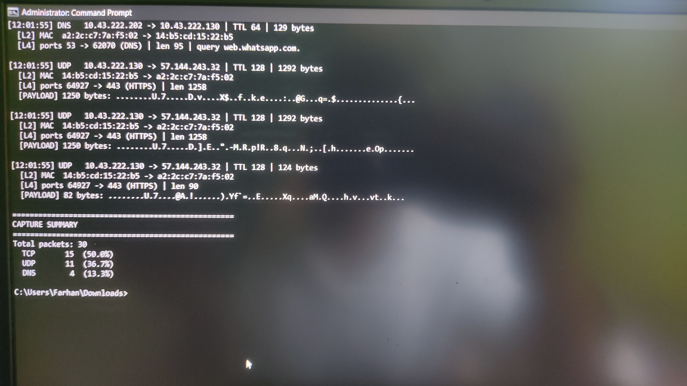

# CodeAlpha_NetworkSniffer
basic network sniffer
# CodeAlpha Internship: Task 1 - Basic Network Sniffer

**Intern:** Farhan Shaikh (TE IT, Savitribai Phule Pune University)
**Internship:** CodeAlpha, Cyber Security Domain

## Objective
Build a Python program that captures live network traffic, analyzes packet structure, and displays useful information such as source/destination IPs, protocols and payloads.

## Tools Used
- Python 3
- Scapy (packet capture and dissection)

## Features
- Shows source and destination IP addresses, MAC addresses, TTL and packet size
- Identifies protocols: TCP, UDP, ICMP, DNS and ARP
- Shows ports with common service names (HTTP, HTTPS, SSH, DNS, etc.)
- Decodes TCP flags (SYN, ACK, FIN, RST, PSH, etc.)
- Displays a printable payload preview and detects HTTP request lines
- Supports BPF filters, packet count limit and interface selection
- Saves captures to `.pcap` for analysis in Wireshark
- Prints a protocol summary when stopped (Ctrl+C)

## Setup
```bash
pip install scapy
```
- **Windows:** install [Npcap](https://npcap.com) and run the terminal as Administrator.
- **Linux / macOS:** run with `sudo`.

## Usage
```bash
python network_sniffer.py -c 30                       # Windows: capture 30 packets
sudo python3 network_sniffer.py -c 30                 # Linux / macOS
python network_sniffer.py -f "tcp port 80" -c 20      # only HTTP traffic
python network_sniffer.py -f icmp -c 10               # only ping traffic
python network_sniffer.py -i eth0 -w out.pcap         # choose interface, save to pcap
```

| Option | Meaning |
|---|---|
| `-i` | Network interface |
| `-c` | Number of packets to capture (0 = unlimited) |
| `-f` | BPF capture filter |
| `-w` | Save captured packets to a pcap file |

## Sample Output


## How Data Flows (What I Learned)
- Packets are layered: Ethernet (L2) → IP (L3) → TCP/UDP/ICMP (L4) → payload.
- DNS resolves domain names (e.g. `web.whatsapp.com`) to IP addresses before a connection starts.
- TCP connections begin with a SYN → SYN-ACK → ACK handshake; `PSH+ACK` marks data being sent.
- Port 443 traffic is encrypted (HTTPS/TLS), so payloads look like random bytes. Plain HTTP on port 80 would expose readable text.
- UDP on port 443 is typically QUIC, a fast encrypted transport used by browsers and apps.

## Ethics
Only capture traffic on networks you own or have permission to monitor.
